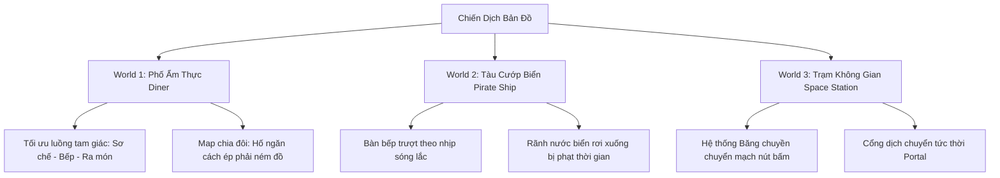

# BÁO CÁO TOÀN DIỆN DỰ ÁN CHAOS KITCHEN & ĐỊNH HƯỚNG PHÁT TRIỂN TIẾP THEO

> **Ngày lập báo cáo:** 09/10/2026  
> **Trạng thái hệ thống:** Ổn định (100% tests pass trên cả 3 workspace: `@kitchen/core`, `apps/server`, `apps/client`)  
> **Mục đích:** Tổng hợp hiện trạng toàn bộ dự án, phân tích ưu nhược điểm của gameplay/map hiện tại, và xây dựng kế hoạch nâng cấp bản đồ chơi và kho món ăn phong phú.

---

## MỤC LỤC
1. [Tổng Quan Dự Án & Kiến Trúc Hệ Thống](#1-tổng-quan-dự-án--kiến-trúc-hệ-thống)
2. [Bảng Tổng Hợp Toàn Bộ Tính Năng Đã Hoàn Thành](#2-bảng-tổng-hợp-toàn-bộ-tính-năng-đã-hoàn-thành)
3. [Hiện Trạng Nội Dung (Bản Đồ, Món Ăn & Tài Nguyên 3D)](#3-hiện-trạng-nội-dung-bản-đồ-món-ăn--tài-nguyên-3d)
4. [Đánh Giá Điểm Mạnh & Những Hạn Chế Hiện Tại](#4-đánh-giá-điểm-mạnh--những-hạn-chế-hiện-tại)
5. [Định Hướng Nâng Cấp & Tối Ưu Bản Đồ Chơi (Map Design)](#5-định-hướng-nâng-cấp--tối-ưu-bản-đồ-chơi-map-design)
6. [Hệ Thống Món Ăn Mới & Trạm Nấu Mới Đề Xuất](#6-hệ-thống-món-ăn-mới--trạm-nấu-mới-đề-xuất)
7. [Lộ Trình Triển Khai Chi Tiết (Roadmap)](#7-lộ-trình-triển-khai-chi-tiết-roadmap)
8. [Hướng Dẫn Kỹ Thuật Khi Triển Khai Thêm Map & Món Mới](#8-hướng-dẫn-kỹ-thuật-khi-triển-khai-thêm-map--món-mới)

---

## 1. TỔNG QUAN DỰ ÁN & KIẾN TRÚC HỆ THỐNG

Dự án **Chaos Kitchen** là một web game multiplayer mô phỏng căn bếp hỗn loạn (lấy cảm hứng từ *Overcooked*), phát triển trên nền tảng monorepo (quản lý bằng `pnpm`).

```
chaos-kitchen2/
├── packages/core/       # Engine logic thuần TypeScript, mô phỏng 30Hz xác định (Deterministic)
├── apps/server/         # WebSocket Game Server dựa trên Colyseus
└── apps/client/         # Web Client (Vite + Vanilla TS + Three.js 3D Engine + UI Glassmorphism)
```

### Kiến Trúc Kỹ Thuật Nổi Bật:
- **Deterministic Core (`@kitchen/core`)**: Toàn bộ logic vật lý va chạm, trạng thái món ăn, công thức, lửa/nước, timer đều là pure functions không phụ thuộc DOM hay Node.js. Chạy ở tần số cố định **30 Hz**. Đảm bảo kiểm thử tự động đạt độ tin cậy tuyệt đối (Golden Hashes).
- **Authoritative Server (`apps/server`)**: Máy chủ Colyseus chạy vòng lặp mô phỏng chính thức, kiểm soát xác thực input (rate-limit, sanitize, chống gian lận), broadcast delta snapshot mỗi 2 tick (15 Hz) và hỗ trợ cơ chế Reconnection Grace Period.
- **Client Prediction & Reconciliation (`apps/client`)**:
  - Dự đoán chuyển động phía máy khách (`Predictor.ts`) giúp người chơi điều khiển mượt mà, không cảm thấy độ trễ mạng.
  - Tự động lerp sửa sai lệch nếu vị trí sai số nằm trong khoảng `[0.05, 1.5]` mét; snap nếu độ lệch quá lớn.
- **Dual Renderer (3D First, 2D Fallback)**:
  - Renderer 3D chính xây dựng bằng **Three.js** với asset low-poly tối ưu, lighting, camera isometric, hạt lửa/khói và animation xương đầy đủ.
  - Renderer 2D Canvas giữ vai trò dự phòng hiệu năng cao.

---

## 2. BẢNG TỔNG HỢP TOÀN BỘ TÍNH NĂNG ĐÃ HOÀN THÀNH

| Nhóm Tính Năng | Chi Tiết Đã Hoàn Thiện | Trạng Thái |
|---|---|:---:|
| **Di Chuyển & Sprint V2** | - Di chuyển 8 hướng mượt mà, tính toán gia tốc và ma sát thực tế.<br>- Tương tác sàn trơn trượt (`ice`) và hố ngăn cách (`pit`).<br>- **Sprint V2 mới nhất**: Giữ Shift sprint với năng lượng 3.0s, tiêu hao 1/s, tốc độ $\times 1.5$ (3.9 m/s). Năng lượng cạn dừng ngay, hồi 1/s sau 0.5s trễ, chống nhấp nháy ngưỡng 0.2. Ném và tương tác hoàn toàn tự do khi đang sprint. | ✅ Hoàn thiện |
| **Sơ Chế & Nấu Nướng** | - Bàn thớt (`cutting`): Băm cà chua, xà lách, hành tây, nấm theo tiến trình tròn.<br>- Bếp lò (`stove`): Chảo rán (`pan`) rán thịt patty; Nồi hầm (`pot`) nấu các loại súp.<br>- Cháy khét & Hỏa hoạn: Quá giờ nấu sẽ cháy, bốc lửa, cháy lan sang bàn bên cạnh; Dập lửa bằng bình cứu hỏa (`E`).<br>- Xếp đĩa (`plate`): Xếp nguyên liệu theo thứ tự chuẩn, tự động ghép công thức món. | ✅ Hoàn thiện |
| **Rửa Bát & Chu Trình Đĩa** | - Khách ăn xong trả đĩa bẩn về cửa trả (`dish_return`) hoặc bàn ăn (`table`).<br>- Mang đĩa bẩn đến bồn rửa (`sink`), giữ nút tương tác để rửa sạch theo thời gian thực.<br>- Xếp đĩa sạch về quầy để tái sử dụng. | ✅ Hoàn thiện |
| **Cơ Chế Ném & Bắt (Throw/Catch)** | - Bấm phím Ném (`Space`) để phi nguyên liệu/đĩa bay qua đầu người chơi hoặc qua hố (`pit`).<br>- Bán kính bắt tự động (`CATCH_RADIUS = 0.6m`) giúp phối hợp từ xa cực kỳ ăn ý. | ✅ Hoàn thiện |
| **Khách Ăn Tại Chỗ (Dine-in)** | - Khách hàng xuất hiện ngẫu nhiên, tự tìm đến bàn ăn (`table` / `Q`).<br>- Animation ngồi ăn chuyên dụng (`sitting`), hiển thị yêu cầu món ăn trực tiếp trên đầu.<br>- Ăn xong để lại đĩa bẩn và tiền boa (Tip). | ✅ Hoàn thiện |
| **Đơn Hàng & Điểm Số** | - Hệ thống Order Ticket có thanh kiên nhẫn (Patience Bar) đổi màu xanh/vàng/đỏ.<br>- Combo hoàn thành đơn liên tiếp tăng tiền boa (Tip streak).<br>- Hệ thống tính sao chiến dịch (1, 2, 3 sao) theo mốc điểm đạt được. | ✅ Hoàn thiện |
| **Chế Độ Chơi (Game Modes)** | - **Multiplayer**: Tạo phòng 4 ký tự, chia sẻ link mời, đổi màu nhân vật, sẵn sàng, chọn màn.<br>- **Solo Mode**: Tùy chọn chơi 1 mình điều khiển chuyển đổi giữa 2 đầu bếp hoặc có Bot AI thông minh hỗ trợ. | ✅ Hoàn thiện |
| **Animation & Gắn Vật Phẩm** | - 7 Clip animation hoàn chỉnh: `idle`, `run`, `carry_idle`, `carry_run`, `chop`, `wash`, `sitting`.<br>- Hệ thống gắn vật phẩm cầm trên tay (`carry`) ở phía trước ngực với tỷ lệ scale chuẩn, bám chuyển động cơ thể không bị xuyên thân. | ✅ Hoàn thiện |
| **Giao Diện (UI/HUD)** | - HUD phong cách Glassmorphism hiện đại: Thanh Stamina Sprint hình tia sét ⚡ chuyển màu mượt mà, báo động đỏ khi cạn kiệt.<br>- Bản đồ chiến dịch trực quan (Campaign Map) hiển thị tổng sao, khóa/mở màn theo sao. | ✅ Hoàn thiện |

---

## 3. HIỆN TRẠNG NỘI DUNG (BẢN ĐỒ, MÓN ĂN & TÀI NGUYÊN 3D)

### 3.1. Các Màn Chơi (Levels) Hiện Có
Hiện tại game có **5 màn chơi** được khai báo trong `@kitchen/core`:

1. **`tutorial` (Màn Hướng Dẫn - World 0)**:
   - Bản đồ mở, thời gian vô tận, hướng dẫn băm xà lách, ghép đĩa salad cơ bản.
2. **`level1` (Bếp Nhỏ - World 1)**:
   - Layout chữ nhật cơ bản ($20 \times 10$). Có thùng cà chua, xà lách, thịt, bánh mì, 1 chảo rán, 1 bồn rửa, 4 bàn ăn khách ngồi (`Q`). Món: *Salad, Burger*.
3. **`level2` (Hai Bên Quầy - World 1)**:
   - Layout hẹp ngang ($14 \times 9$), quầy bếp chia làm 2 bên, có 2 chảo rán. Món: *Salad, Burger, Burger Cà Chua*.
4. **`level3` (Bếp Hỗn Loạn - World 1)**:
   - Layout lớn hơn ($16 \times 11$), có lối đi chia đôi trên-dưới, quầy chắn ở giữa tạo nút thắt. Món: *Salad, Burger, Burger Cà Chua*.
5. **`b08` (Màn Test Băng Chuyền)**:
   - Màn thử nghiệm băng chuyền (`conveyor`) tự động di chuyển đồ vật.

> **Nhận xét về bản đồ hiện tại:** Tất cả các màn chơi hiện tại đều thuộc theme `diner` (quán ăn thông thường). Bản đồ còn mang tính "mặt phẳng tĩnh", chưa có chướng ngại vật động, chưa có phân tách nhiệm vụ bắt buộc bằng địa hình (như hố sâu, xe cộ, sông nước).

---

### 3.2. Danh Mục Món Ăn (Recipes) Hiện Có
Hiện tại trong `packages/core/src/recipes.ts` có **6 món ăn**:

| Món Ăn | Nguyên Liệu Thành Phần | Công Đoạn Chế Biến | Điểm Thưởng |
|---|---|---|:---:|
| **Salad** | Xà lách băm + Cà chua băm | 2 lần băm $\rightarrow$ Lên đĩa | 20 điểm |
| **Burger** | Bánh mì + Thịt chín + Xà lách băm | 1 băm, 1 rán chảo $\rightarrow$ Lên đĩa | 35 điểm |
| **Burger Cà Chua** | Bánh mì + Thịt chín + Xà lách băm + Cà chua băm | 2 băm, 1 rán chảo $\rightarrow$ Lên đĩa | 45 điểm |
| **Tomato Soup** | 3 Cà chua băm | Nấu trong nồi hầm (`pot`) | 40 điểm |
| **Onion Soup** | 3 Hành tây băm | Nấu trong nồi hầm (`pot`) | 40 điểm |
| **Mushroom Soup** | 3 Nấm băm | Nấu trong nồi hầm (`pot`) | 40 điểm |

> **Nhận xét về món ăn:** Các món ăn hiện tại chủ yếu xoay quanh 2 dụng cụ nấu là **Chảo** và **Nồi hầm**. Chưa có món nướng (Oven), món chiên ngập dầu (Fryer), món tráng miệng hoặc đồ uống.

---

### 3.3. Kho Tài Nguyên 3D Sẵn Có Trong Dự Án (Chưa Khai Thác Hết)
Dự án đã tích hợp sẵn thư viện tài sản phong phú từ Kenney (`kenney_food-kit`, `kenney_furniture-kit`), đã có sẵn trong source code nhưng game logic chưa kích hoạt:

- **Nguyên liệu / Món ăn sẵn model**:
  - *Pizza*: `pizza.glb`, `pizza-box.glb`, `cheese.glb` (Phô mai), `paprika.glb` (Ớt chuông).
  - *Đồ chiên / Fastfood*: `fries.glb` (Khoai tây chiên), `hot-dog.glb`, `corn-dog.glb`.
  - *Đồ uống / Máy pha chế*: `cup-coffee.glb`, `frappe.glb`, `soda.glb`, `kitchenCoffeeMachine.glb`, `kitchenBlender.glb`.
  - *Tráng miệng*: `cake.glb`, `donut.glb`, `waffle.glb`, `ice-cream.glb`, `pancakes.glb`.
  - *Món Á / Sushi*: `sushi-salmon.glb`, `sushi-egg.glb`, `dim-sum.glb`, `rice-ball.glb`, `fish.glb`, `egg.glb`.
- **Thiết bị nhà bếp sẵn model**:
  - `kitchenStoveElectric.glb` (Bếp điện / Lò nướng), `kitchenMicrowave.glb` (Lò vi sóng), `kitchenFridge.glb` (Tủ lạnh), `toaster.glb` (Máy nướng bánh mì).

---

## 4. ĐÁNH GIÁ ĐIỂM MẠNH & NHỮNG HẠN CHẾ HIỆN TẠI

### Điểm Mạnh (Strengths):
1. **Engine cực kỳ vững chắc**: Core deterministic, code sạch, có bộ test tự động phủ kín từ va chạm, ném đồ đến sprint.
2. **Cảm giác điều khiển (Game Feel) rất tốt**: Tốc độ đầu bếp đã được cân chỉnh đầm tay, cơ chế Sprint V2 linh hoạt, ném đồ mượt mà.
3. **Đầy đủ hạ tầng multiplayer**: Kiến trúc phòng, bot solo, đồng bộ hóa vị trí và trạng thái bếp qua mạng đều hoạt động trơn tru.

### Những Điểm Hạn Chế Cần Cải Thiện Để Thu Hút Người Chơi:
1. **Thiết kế Map còn đơn điệu, dễ va vào nhau**:
   - Các map hiện tại phần lớn là các phòng vuông vức với quầy xếp quanh mép tường. Người chơi thường tụ tập ở giữa phòng, dễ gây tắc đường và cản trở nhau.
   - Chưa tận dụng tính năng **Hố sâu (`pit`)** để buộc người chơi phải ném nguyên liệu qua lại (đây là tính năng vui nhất của dòng game này).
   - Bàn ăn của khách (`table`) hiện nằm chung sàn với bếp, làm rối loạn không gian di chuyển giữa nấu nướng và phục vụ.
2. **Cách chơi chưa đa dạng về nhịp điệu (Pacing)**:
   - Các màn chơi chưa có tính bất ngờ (như động đất làm trượt bàn, xe chạy ngang qua đường, lửa bùng phát ngẫu nhiên, hoặc băng chuyền đổi chiều).
3. **Món ăn thiếu công đoạn kết hợp mới lạ**:
   - Người chơi mới vào chơi vài màn sẽ cảm thấy lặp lại vì chỉ có "Băm" và "Rán/Hầm". Cần thêm các trạm thao tác mới như "Nướng lò", "Chiên dầu", "Xay sinh tố" để chia việc cho 2-4 người chơi phối hợp nhịp nhàng.

---

## 5. ĐỊNH HƯỚNG NÂNG CẤP & TỐI ƯU BẢN ĐỒ CHƠI (MAP DESIGN OVERHAUL)

Để các màn chơi trở nên hấp dẫn, kịch tính và khuyến khích tinh thần đồng đội cao hơn, chúng ta nên tái cấu trúc hệ thống Map theo 3 Thế Giới (Worlds) với cơ chế đặc trưng:



### 5.1. Triết Lý Thiết Kế Bản Đồ Cải Tiến
- **Quy tắc Tam Giác Vàng (Working Triangle)**: Tủ nguyên liệu $\rightarrow$ Bàn thớt/Bếp $\rightarrow$ Quầy ra đĩa phải tạo thành luồng 1 chiều, tránh để hai người chơi phải đi ngược chiều nhau trên hành lang hẹp 1 ô.
- **Hành lang tối thiểu 2 ô**: Ở các trục di chuyển chính giữa bếp và khu phục vụ, lối đi nên rộng tối thiểu 2 ô gạch (`..`) để hai đầu bếp có thể lướt qua nhau mà không bị cấn va chạm (`PLAYER_COLLIDE`).
- **Phân tách Khu Bếp và Khu Bàn Khách**: Khu vực khách ngồi ăn (`Q`) nên được gom thành khu sảnh tiệc riêng hoặc ngăn bởi quầy phục vụ có khe đưa đĩa, giúp căn bếp nhìn chuyên nghiệp và gọn gàng.

---

### 5.2. Đề Xuất Thiết Kế 4 Màn Chơi Cụ Thể Cực Kỳ Hấp Dẫn

####  Map 1-1: "Bếp Đôi Song Hành" (Diner - Cải tiến Level 1)
- **Ý tưởng**: Căn bếp được chia thành 2 nửa đối xứng bởi 1 dãy quầy ở giữa. 
- **Bố cục**:
  - Nửa bên trái: Chuyên Sơ Chế (Thùng nguyên liệu + Thớt + Bồn rửa chén).
  - Nửa bên phải: Chuyên Nấu Nướng & Lên Đĩa (Bếp chiên + Nồi hầm + Tủ đĩa + Cửa ra món).
  - Ở giữa là bàn chuyền đồ (`Counter X`). Hai người chơi buộc phải chuyền hoặc ném đồ qua bàn giữa, tạo cảm giác phối hợp ăn ý ngay từ màn đầu tiên.

####  Map 1-2: "Vực Thẳm Giữa Bếp" (Diner / Canyon)
- **Ý tưởng**: Khai thác tối đa cơ chế **Hố sâu (`_`)**.
- **Bố cục**: Một hố sâu 2 ô ngăn cách hoàn toàn 2 đầu bếp. Bên A có nguyên liệu nhưng không có bếp. Bên B có bếp nhưng không có nguyên liệu. 
- **Gameplay**: Đầu bếp A phải ném (`Throw`) cà chua, thịt bay qua hố cho đầu bếp B. Đầu bếp B nấu chín rồi ném trả đĩa hoặc đặt lên băng chuyền đưa về quầy phục vụ.

####  Map 2-1: "Sóng Gió Mạn Thuyền" (Theme: Ship)
- **Ý tưởng**: Bếp trên tàu hải tặc, sàn lắc lư.
- **Bố cục & Cơ chế**: Sử dụng sàn băng (`~`) giả lập mặt sàn trơn ướt nước biển. Ở giữa thuyền có 2 bàn thớt/chảo trượt qua lại mỗi 15 giây (sử dụng logic dịch chuyển vị trí station), đòi hỏi người chơi phải canh thời điểm đón bàn.

####  Map 3-1: "Ma Trận Băng Chuyền" (Theme: Space)
- **Ý tưởng**: Trạm vũ trụ công nghệ cao.
- **Bố cục & Cơ chế**: Có 2 làn băng chuyền (`>`, `<`) chạy ngược chiều nhau chở đĩa bẩn và đồ ăn thành phẩm qua các buồng cách ly. Người chơi phải căn nhịp đặt đĩa lên băng chuyền đúng lúc.

---

## 6. HỆ THỐNG MÓN ĂN MỚI & TRẠM NẤU MỚI ĐỀ XUẤT

Để tạo sự phong phú vượt bậc trong lối chơi, đề xuất mở rộng hệ thống trạm nấu và món ăn thành các nhóm chủ đề ẩm thực:

```
[Nguyên Liệu Mới] ──(Sơ chế / Băm)──> [Trạm Chế Biến Mới] ──(Ghép Lên Đĩa)──> [Món Ăn Hoàn Chỉnh]
  - Bột mì (Dough)                       - Lò nướng (Oven)                      - Pizza Phô Mai / Xúc Xích
  - Phô mai (Cheese)                     - Nồi chiên (Fryer)                    - Khoai Tây Chiên (Fries)
  - Khoai tây (Potato)                   - Máy xay (Blender)                    - Sinh Tố Trái Cây (Smoothie)
  - Rong biển + Cá (Fish)                - Nồi cơm (Rice Pot)                   - Sushi Cá Hồi (Sushi)
```

### 6.1. Chi Tiết Các Món Ăn Mới Đề Xuất Triển Khai

#### Nhóm 1: Pizza Nướng Lò (Đậm chất Chaos Kitchen)
- **Thiết bị mới**: Trạm Lò Nướng (`Oven` - ký tự ASCII mới: `O`).
- **Nguyên liệu mới**: Bột mì (`dough`), Phô mai (`cheese`), Xúc xích (`sausage`).
- **Quy trình chế biến**:
  1. Lấy Bột mì $\rightarrow$ Đặt lên thớt đập dẹp.
  2. Băm Cà chua $\rightarrow$ Thêm sốt cà chua lên đế bánh.
  3. Băm Phô mai $\rightarrow$ Rải phô mai lên đế bánh.
  4. (Tùy chọn) Thêm xúc xích băm hoặc nấm băm.
  5. Đưa cả bánh sống vào **Lò nướng (`Oven`)** trong 10 giây $\rightarrow$ Lấy ra đặt lên đĩa/hộp pizza.
  - *Nguy cơ*: Để quên trong lò quá 6 giây sau khi chín sẽ bốc cháy!

#### Nhóm 2: Đồ Ăn Nhanh & Chiên Ngập Dầu (Fast Food & Fryer)
- **Thiết bị mới**: Nồi chiên ngập dầu (`Fryer` - ký tự ASCII: `F`).
- **Nguyên liệu mới**: Khoai tây (`potato`).
- **Món ăn**:
  - **Khoai tây chiên (French Fries)**: Lấy khoai tây $\rightarrow$ Băm thái sợi trên thớt $\rightarrow$ Thả vào nồi chiên 6s $\rightarrow$ Vớt ra khay/đĩa. (Món phụ kèm Burger điểm cực cao).

#### Nhóm 3: Đồ Uống & Tráng Miệng (Giải Khát Tức Thì)
- **Thiết bị mới**: Máy xay sinh tố (`Blender` - ký tự ASCII: `K`).
- **Nguyên liệu mới**: Dưa hấu (`watermelon`), Dâu tây (`strawberry`).
- **Quy trình chế biến**:
  - Cho hoa quả đã băm vào máy xay $\rightarrow$ Bấm nút xay 4s $\rightarrow$ Rót ra ly (`cup`) phục vụ trực tiếp (không cần đĩa, không lo cháy nổ). Đây là món cứu cánh giải tỏa áp lực khi các bếp nấu chính đang quá tải.

#### Nhóm 4: Sushi Nhật Bản (Ẩm thực Tinh Tế)
- **Nguyên liệu mới**: Rong biển (`seaweed`), Gạo/Cơm (`rice`), Cá hồi (`salmon`).
- **Quy trình chế biến**:
  - Nấu cơm trong nồi $\rightarrow$ Trải lên lá rong biển $\rightarrow$ Thêm cá hồi đã thái lát $\rightarrow$ Cuộn lại thành đĩa Sushi.

---

## 7. LỘ TRÌNH TRIỂN KHAI CHI TIẾT (ROADMAP)

Kế hoạch phát triển được chia làm 3 giai đoạn rõ ràng nhằm đảm bảo game luôn chạy ổn định, không làm gián đoạn mã nguồn hiện có:

```
[Giai Đoạn 1: Cải Tiến Map & Món Pizza] ──> [Giai Đoạn 2: Trạm Chiên & World 2 Tàu Biển] ──> [Giai Đoạn 3: Đồ Uống & Sự Kiện Động]
       (Ưu tiên làm ngay)                          (Mở rộng trải nghiệm)                       (Hoàn thiện đánh bóng)
```

###  Giai Đoạn 1: Tái Thiết Kế Map & Ra Mắt Nhóm Món Pizza (1 - 2 tuần)
- **Mục tiêu**: Nâng cấp trải nghiệm cơ bản, giải quyết vấn đề tắc nghẽn bản đồ và bổ sung nhóm món ăn nướng hấp dẫn.
- **Công việc cụ thể**:
  1. **Map Refactoring**:
     - Cải tạo lại `level1`, `level2`, `level3` theo luồng di chuyển 2 ô thoáng đãng.
     - Tạo thêm 2 map mới: **Map 1-1** (Bếp Đôi ném đồ qua bàn giữa) và **Map 1-2** (Vực thẳm chia cắt bếp).
  2. **Thêm Trạm Lò Nướng (`Oven`)**:
     - Đăng ký ký tự `O` trong Level Parser.
     - Gắn model `kitchenStoveElectric.glb` làm lò nướng trong Renderer 3D.
  3. **Thêm Công Thức Pizza**:
     - Thêm nguyên liệu `cheese`, `dough` vào `constants.ts` và `recipes.ts`.
     - Tích hợp asset `pizza.glb`, `cheese.glb` từ Kenney Food Kit.

###  Giai Đoạn 2: Mở Rộng World 2 (Tàu Biển) & Trạm Chiên Khoai Tây (2 - 3 tuần)
- **Mục tiêu**: Đưa người chơi sang môi trường mới với cơ chế địa hình đặc thù.
- **Công việc cụ thể**:
  1. Thêm theme đồ họa `ship` (nền sàn gỗ boong tàu, lan can mạn thuyền, rãnh nước biển).
  2. Bổ sung cơ chế sàn trơn và quầy di chuyển theo chu kỳ sóng lắc.
  3. Thêm trạm nồi chiên (`Fryer`) và món Khoai tây chiên giòn phục vụ kèm Combo Burger.

###  Giai Đoạn 3: Sự Kiện Ngẫu Nhiên, Đồ Uống & Đánh Bóng Toàn Diện (2 tuần)
- **Mục tiêu**: Đạt chất lượng hoàn thiện của một game thương mại indie.
- **Công việc cụ thể**:
  1. Thêm máy xay sinh tố (`Blender`) và nhóm đồ uống hoa quả.
  2. Thêm sự kiện đột xuất: Khách VIP đòi ăn gấp (x3 điểm), mất điện tạm thời, hoặc chuột trộm đồ ăn.
  3. Bổ sung hiệu ứng âm thanh (SFX) cho lò nướng ding!, tiếng dầu chiên xèo xèo, nhạc nền rộn ràng theo nhịp độ countdown.

---

## 8. HƯỚNG DẪN KỸ THUẬT KHI TRIỂN KHAI THÊM MAP & MÓN MỚI

Khi bạn hoặc đội ngũ bắt đầu code các tính năng mới, dưới đây là "kim chỉ nam" chuẩn kiến trúc đã thiết lập trong dự án:

### 8.1. Các Bước Thêm Một Món Ăn Mới (Ví dụ: Pizza)
1. **Khai báo ID trong Core**:
   - Mở `packages/core/src/types.ts`: Thêm `'pizza'` vào type `RecipeId`; thêm `'dough'`, `'cheese'` vào `IngredientId`.
2. **Khai báo Điểm số & Thứ tự xếp đĩa**:
   - Mở `packages/core/src/constants.ts`: Thêm điểm vào `RECIPE_SCORE['pizza'] = 55`, thêm nguyên liệu vào `PLATE_ORDER`.
3. **Định nghĩa Công thức**:
   - Mở `packages/core/src/recipes.ts`: Khai báo cấu trúc các thành phần trong `RECIPES['pizza']`.
4. **Ánh xạ Model 3D ở Client**:
   - Mở `apps/client/src/game/renderer3d/` (hoặc asset mapping): Liên kết `'cheese'` $\rightarrow$ `cheese.glb`, `'pizza'` $\rightarrow$ `pizza.glb`.
5. **Viết Test xác minh**:
   - Thêm test case vào `packages/core/src/__tests__/recipes.test.ts` để đảm bảo logic ghép đĩa đúng 100%.

### 8.2. Các Bước Tạo & Đăng Ký Một Bản Đồ Mới
1. **Vẽ bản đồ ASCII**:
   - Tạo file `packages/core/src/levels/level_new.ts`.
   - Sử dụng các ký tự chuẩn: `#` (tường), `.` (sàn), `X` (quầy), `C` (thớt), `S` (bếp), `P` (tủ đĩa), `D` (thùng rác), `W` (bồn rửa), `_` (hố ném), `1-4` (vị trí spawn).
2. **Đăng ký vào Danh Sách Level**:
   - Mở `packages/core/src/levels/index.ts`: Import và đưa `level_new` vào mảng `LEVELS`.
3. **Chạy kiểm tra tính hợp lệ**:
   - Chạy lệnh `pnpm --filter @kitchen/core test` để hệ thống tự động kiểm tra xem map có đủ thùng nguyên liệu, có lối đi tới bàn thớt và bếp hay không.

---

## TỔNG KẾT & LỜI KHUYÊN DÀNH CHO BẠN

Dự án hiện tại của bạn đã sở hữu **bộ khung kỹ thuật (Core Engine, Network, 3D Rendering) vô cùng chất lượng và hiếm có** ở các dự án web game thông thường. Hệ thống chịu tải tốt, không giật lag, cơ chế ném đồ và sprint đã đạt độ hoàn thiện cao.

**Bước đi thông minh nhất hiện tại:**
> **Tập trung 100% vào CONTENT & LEVEL DESIGN**:
> 1. Thiết kế lại 2 - 3 map chơi có điểm nhấn (đặc biệt là map có hố sâu để phát huy hết tính năng ném đồ cực kỳ thú vị của game).
> 2. Thêm ngay món **Pizza (Lò nướng)** vì assets đã có sẵn đầy đủ trong máy, chỉ cần kích hoạt logic công thức.
> 
> Việc này sẽ biến Chaos Kitchen từ một "bản demo kỹ thuật hoàn hảo" thành một "trò chơi thực thụ cuốn hút người chơi hàng giờ liền"!
