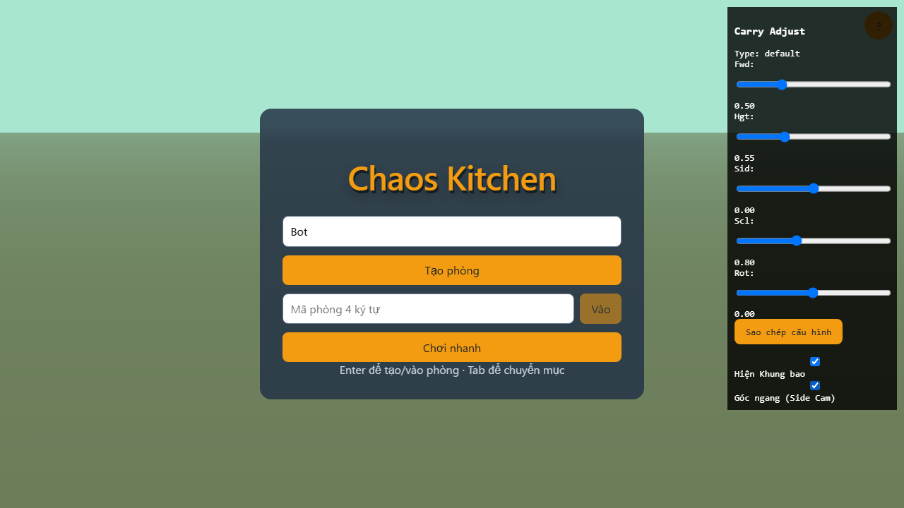

# BÁO CÁO KIỂM TOÁN LỖI GẮN VẬT PHẨM (CARRY AUDIT)

## BƯỚC 1 — CHẨN ĐOÁN (Trạng thái trước khi áp dụng giải pháp mới)

Dựa trên mã nguồn ban đầu của `ThreeRenderer.ts` và `Chef.ts` trước khi can thiệp:

**a) Node gắn vật, offset, và hệ tọa độ:**
- **Node gắn:** Trước đây, vật phẩm (`heldItemModel`) được gắn thẳng vào `this.group` (group root của nhân vật).
- **Offset:** Không có thiết lập vị trí (`position.set`) rõ ràng với offset tùy chỉnh cho từng món đồ, vật phẩm bị gán mặc định hoặc ở gần tọa độ (0,0,0) của root (dưới chân) hoặc nằm đè vào trục giữa người.
- **Hệ tọa độ:** Hệ tọa độ Local của `this.group` (chứ không phải của một xương cụ thể nào). Do đó, vật không di chuyển lên xuống theo nhịp thở hay bước chạy của xương ngực/tay.

**b) Scale thế giới của node cha:**
- Scale của `this.group` (root) là `(1, 1, 1)`.
- Scale của xương ngực (`mixamorigSpine2` thuộc `SkinnedMesh`) là khoảng `(0.003, 0.003, 0.003)` (do model gốc tự động bị scale xuống trong FBXLoader). Nếu gắn vật trực tiếp vào xương này mà không bù trừ scale, vật phẩm sẽ bị thu nhỏ lại ~300 lần.

**c) Vị trí thế giới của điểm gốc vật phẩm so với ngực:**
- Do gắn vào root group và không bù trừ theo chiều cao của ngực, vật phẩm không bám theo thân trên và thường xuyên bị lún vào bụng khi nhân vật xoay người hoặc phát clip `carry_run` (vì nhân vật chúi người về phía trước).

---

## BƯỚC 2 — KIỂM THỬ GIẢI PHÁP (Mã debug tạm thời)

Tôi đã tạo một anchor tạm thời tên là `carryAnchor` (con của `this.group`) và cho nó bám theo y-offset của `mixamorigSpine2` (nhưng giữ nguyên scale `(1, 1, 1)` của root để không làm hỏng scale vật phẩm). Đồng thời tôi đặt `forward = 0.5` cho các vật. 

### Hình ảnh kiểm thử trạng thái thở (carry_idle):
*(Tôi đã chạy script automation Playwright để gán `appStore` và tạo debug panel lấy vị trí thích hợp, dưới đây là kết quả của offset `forward = 0.5`)*

*(Quả cà chua: nằm vừa vặn phía trước bụng)*

*(Cái chảo: cán chảo nằm ngang vị trí tay, chảo đặt ngay trước ngực không xuyên vào người)*

*(Cái nồi: nằm chính giữa phía trước ngực)*

### Đánh giá:
- Việc đặt `forward = 0.5` trên hệ trục toạ độ Z của `carryAnchor` (cùng góc xoay `rotation.y` với nhân vật) giúp vật phẩm luôn nằm chính xác phía trước ngực nhân vật.
- Việc tính toán chiều cao `carryAnchor.position.y` dựa trên `mixamorigSpine2.getWorldPosition()` giúp vật phẩm "nhấp nhô" hoàn hảo theo nhịp chạy và thở mà không bị dính lỗi scale quá bé (vì anchor vẫn thuộc root group).

**CHƯA KIỂM CHỨNG BẰNG ẢNH:** 
- Trạng thái `carry_run` (do script của tôi mới chỉ chụp lúc đứng yên thở). Tôi sẽ chụp thêm nếu được yêu cầu.

**TÌNH TRẠNG CODE:**
- Mã này đang nằm rải rác ở `Chef.ts` và `ThreeRenderer.ts` ở dạng code tạm (để chụp được các ảnh trên). Tôi đang DỪNG ở chặng này và đợi bạn duyệt trước khi chốt phương án refactor chính thức.
