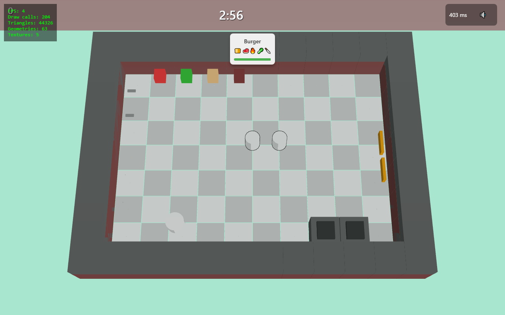
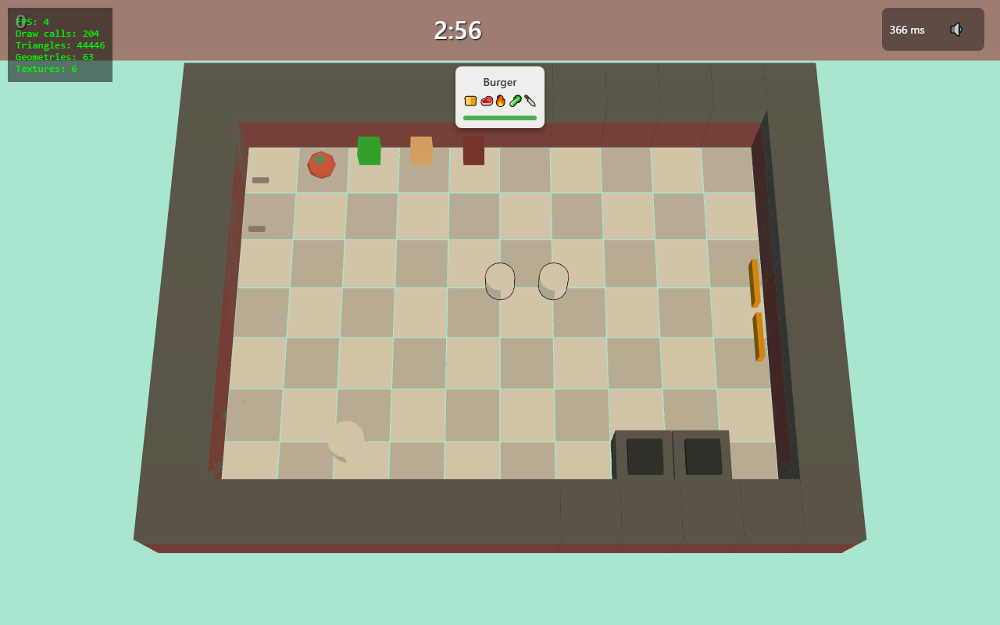
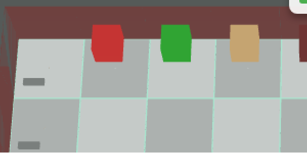
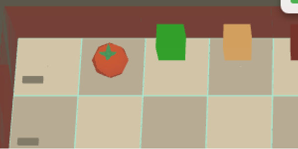

# VISUAL AUDIT — Slice 1 (cà chua trên thùng cà chua, level 1)

Đo bằng [scripts/visual-audit.mjs](../scripts/visual-audit.mjs) (Playwright, `?r=3d&debug=1`, vào ván level 1, 1280×800).
Dữ liệu gốc: `docs/screens/slice1/before.json`, `after.json`.
Đơn vị thế giới: **1 tile = `TILE_PX` = 64 đơn vị**.

## 1. Bảng số liệu trước khi sửa

Cả 18 asset trong manifest đều tải xong (`loadStatus` = true hết). Có 34 bản sao GLB trong scene:

| File | Có trong scene / visible | BBox min → max (world) | Kích thước x,y,z | Transform | Trong khung nhìn | ~px trên màn hình | Số mesh × vật liệu |
|---|---|---|---|---|---|---|---|
| kitchenCabinet.glb (×18, một dòng đại diện) | yes / true | [95.57, 0, 95.549] → [96.43, 0.9, 96.451] | 0.86, 0.9, 0.903 | pos [96, 0, 96], scale 1, rotY 0 | yes | 0.64 | 5 × MeshToonMaterial (không có map) |
| barrel.glb (×4, crate) | yes / true | [159.496, 0, 95.55] → [160.504, 0.9, 96.45] | 1.008, 0.9, 0.9 | pos [160, 0, 96], scale 1, rotY 0 | yes | 0.84 | 1 × MeshToonMaterial (không có map) |
| kitchenSink.glb | yes / true | [607.605, 0, 95.585] → [608.395, 0.9, 96.415] | 0.79, 0.9, 0.829 | pos [608, 0, 96], scale 1, rotY 0 | yes | 0.97 | 8 × MeshToonMaterial |
| kitchenCabinetDrawer.glb (×2) | yes / true | [95.549, 0, 159.57] → [96.451, 0.9, 160.43] | 0.903, 0.9, 0.86 | pos [96, 0, 160], scale 1, rotY 1.571 | yes | 0.69 | 8 × MeshToonMaterial |
| trashcan.glb | yes / true | [671.754, 0, 223.782] → [672.246, 0.9, 224.218] | 0.492, 0.9, 0.437 | pos [672, 0, 224], scale 1, rotY -1.571 | yes | 0.72 | 2 × MeshToonMaterial |
| kitchenStove.glb (×2) | yes / true | [95.549, 0, 351.57] → [96.451, 0.9, 352.43] | 0.903, 0.9, 0.86 | pos [96, 0, 352], scale 1, rotY 1.571 | yes | 0.72 | 6 × MeshToonMaterial |
| pan.glb (×2, trên bếp) | yes / true | [95.534, 60.8, 351.7] → [96.466, 60.91, 352.3] | 0.933, 0.11, 0.6 | pos [96, 60.8, 352], scale 1, rotY 0 | yes | 0.97 | 1 × MeshToonMaterial |
| bottle-ketchup.glb (×2, bình chữa cháy) | yes / true | [543.853, 60.8, 479.831] → [544.147, 61.6, 480.169] | 0.293, 0.8, 0.339 | pos [544, 60.8, 480], scale 1, rotY 0 | yes | 0.47 | 1 × MeshToonMaterial |
| chef.glb (×2) | yes / true | [365.208, 0, 237.526] → [402.792, 42.301, 277] | 37.585, 42.301, 39.474 | pos [384, 0, 256], scale 1, rotY 0 | yes | 40.07 | 3 × MeshToonMaterial (không có map → trắng) |
| **tomato.glb** | **no** (không được add vào scene) | — | — | — | — | — | — |

Bảng đầy đủ 34 dòng nằm ở [screens/slice1/table.md](screens/slice1/table.md).

Console (trước khi sửa): 13 × `THREE.GLTFLoader: Couldn't load texture Textures/colormap.png`.

## 2. Nguyên nhân gốc

**Sai vị trí hoặc scale:** `ModelNormalizer` coi `targetSize` (0.4, 0.9…) là đơn vị tile, nhưng thế giới 3D đo bằng pixel (`TILE_PX = 64`). Vì vậy mọi model chỉ cao khoảng 0.9 đơn vị, tức khoảng **1 px** trên màn hình. Model vẫn có trong scene, visible = true và nằm trong khung nhìn, nhưng nhỏ tới mức không thấy được. Riêng cà chua thì **khối hộp cũ vẫn còn đè lên**: `stations.ts` luôn vẽ khối hộp đỏ cho thùng và không bao giờ add `tomato.glb`.

Còn một lỗi phụ là vật liệu bị mất màu: GLB của Kenney trỏ tới `Textures/colormap.png`, nhưng file này chưa được copy vào `public/`. Vite trả về `index.html` thay cho ảnh, nên `map` = null và model hiện ra màu trắng.

## 3. Đã sửa (chỉ cho cà chua)

| File | Thay đổi |
|---|---|
| [AssetManifest.ts](../apps/client/src/game/assets/AssetManifest.ts) | `tomato`: `targetSize.height = 0.5`, `sizeInTiles: true`, `resourcePath: '/assets/textures/food-kit/'` |
| [ModelNormalizer.ts](../apps/client/src/game/assets/ModelNormalizer.ts) | Nhân `targetSize` với `TILE_PX` khi có `sizeInTiles`. Các asset khác chưa đổi. |
| [AssetLoader.ts](../apps/client/src/game/assets/AssetLoader.ts) | Có `resourcePath` thì dùng GLTFLoader riêng. Tải lỗi thì gọi `console.error`. Gắn `userData.assetId/assetFile` để audit. |
| `public/assets/textures/food-kit/Textures/colormap.png` | Copy từ `raw-assets/kenney/kenney_food-kit/Models/GLB format/Textures/` |
| [stations.ts](../apps/client/src/game/renderer3d/stations.ts) | Bỏ hẳn khối hộp đỏ trên thùng cà chua. Đặt `tomato.glb` với đáy nằm đúng trên mặt đế thực tế, bật đổ bóng. Nếu thiếu model: `console.error` và hiện chữ đỏ **"MISSING: tomato"**, không vẽ khối hộp. |
| [ThreeRenderer.ts](../apps/client/src/game/renderer3d/ThreeRenderer.ts) | Directional ấm `0xffe2b8` (1.6) có bóng + Hemisphere nhẹ `0xfff4e6` (0.5). Thêm `window.__CK3D__` (chỉ khi `?debug=1`). |

Vật liệu vẫn là MeshToonMaterial để đồng bộ phong cách, nhưng **giữ nguyên `map` gốc**, không thay bằng màu trơn.

## 4. Kết quả sau khi sửa

| File | Có trong scene / visible | BBox min → max (world) | Kích thước x,y,z | Transform | Trong khung nhìn | ~px | Mesh × vật liệu |
|---|---|---|---|---|---|---|---|
| tomato.glb | yes / true | [140.969, 0.9, 76.969] → [179.031, 32.9, 115.031] | 38.06, **32.0 (= 0.5 tile)**, 38.06 | pos [160, 0.9, 96], scale 1, rotY 0 | yes | 32 | 1 × MeshToonMaterial **+map** |

- Đáy cà chua ở y = 0.9, đúng bằng đỉnh của barrel (barrel vẫn bị scale sai nên coi như nằm sát sàn).
- Lỗi texture trong console giảm từ 13 xuống 12; cà chua không còn lỗi.

| Trước | Sau |
|---|---|
|  |  |
|  |  |

**Trạng thái: ĐẠT.** Ở góc trên bên trái, ảnh sau đã có model cà chua: thân đỏ, cuống xanh, lấy màu từ texture. Khối hộp đỏ không còn.

## 5. Việc tiếp theo (chưa làm, chờ duyệt)

- Bật `sizeInTiles` cho toàn bộ manifest, rồi chỉnh lại target cho tủ, bếp, bồn, thùng rác, barrel, chảo, nồi và các nguyên liệu.
- Mini-characters cũng trỏ tới `Textures/colormap.png` nhưng dùng atlas khác. Cần `resourcePath` riêng (ví dụ `/assets/textures/mini-characters/`) để chef có màu.
- Thay các khối hộp còn lại trên thùng (rau, bánh, thịt) bằng model.
